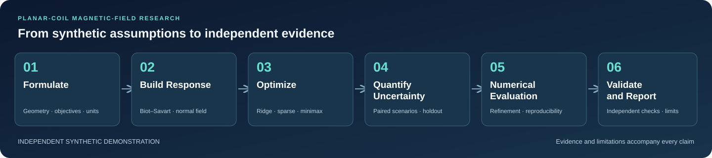

# Robust Optimization and Independent Validation of Planar-Coil Magnetic-Field Models

An independent synthetic research demonstration of magnetic-field correction, constrained optimization, and evidence-based numerical evaluation.



**This is not an official Thea Energy model.** It has no Thea Energy affiliation, endorsement, proprietary geometry, or device validation. The coils, boundary, disturbance, and uncertainty assumptions are synthetic.

| Research status | Current disposition |
|---|---|
| Scientific validation | **PARTIAL** |
| Historical production reproducibility | **FAIL** |
| Upstream attribution | **INCONCLUSIVE** |
| Confinement, equilibrium, or hardware validation | Not established |

These are disclosures of the retained research record, not results of a new execution. This documentation branch starts from the minimal `main` branch and contains only this README and its workflow diagram. The implementation, configurations, tests, and historical evidence remain on the separate [research branch](https://github.com/Nejatbakhsh-y/stellarator-robust-magnetic-optimization/tree/codex/phase2d-upstream-attribution). No scientific acceptance or production readiness is implied by publishing this page.

## Objectives and scope

The project asks how a finite array of planar coils can reduce the normal component of a prescribed disturbance field on a synthetic toroidal surface. It compares dense bounded fitting, sparse current selection, greedy coil removal, and finite-scenario minimax fitting. It also examines uncertainty, discretization error, static coil outages, and the reproducibility of derived metrics.

The central observable is area-weighted boundary normal-field RMS. It is a reduced-order field-correction proxy: reducing it does not establish a self-consistent plasma equilibrium, useful magnetic surfaces, particle confinement, or engineering feasibility.

## Synthetic coil geometry

The demonstration uses a circular torus with major radius 1 m and minor radius 0.25 m:

$$
\mathbf r(\theta,\phi)=((R+a\cos\theta)\cos\phi,\ (R+a\cos\theta)\sin\phi,\ a\sin\theta).
$$

Its outward normal is $(\cos\theta\cos\phi,\cos\theta\sin\phi,\sin\theta)$. Surface quadrature uses the area element $a(R+a\cos\theta)\,d\theta\,d\phi$, with normalized objective weights.

The quick model has 24 circular shaping coils arranged at eight toroidal and three poloidal locations. Each has radius 0.16 m; centers lie on a winding torus of minor radius 0.65 m, with coil planes tangent to that winding surface. A separate synthetic disturbance coil has radius 0.22 m, current 1500 A, center (1.6, 0.25, 0.35) m, and normal proportional to (1, 0.2, 0.4). These choices are research assumptions, not a reconstruction of a commercial device.

## Biot–Savart formulation

For a filamentary coil carrying current $I$, the magnetic field at observation point $\mathbf p$ is

$$
\mathbf B(\mathbf p)=\frac{\mu_0 I}{4\pi}\oint_C
\frac{d\boldsymbol\ell\times(\mathbf p-\mathbf r)}{\lVert\mathbf p-\mathbf r\rVert^3}.
$$

Lengths, currents, and fields are in metres, amperes, and tesla. The implementation uses the conventional approximation $\mu_0=4\pi\times10^{-7}$ H/m. Circular coils are represented by closed inscribed polygons; the production forward calculation sums exact finite straight-segment contributions. Near-wire points are rejected. Exact segment integration does not eliminate the geometric error of approximating a circle by a polygon.

## Magnetic response matrix

Let $A_{ij}=\mathbf n_i\cdot\mathbf B_j(\mathbf p_i;1\,\mathrm A)$ be the unit-current normal response, in T/A, and let $b_i$ be the disturbance normal field. For commanded currents $\mathbf I$, the residual is

$$
\mathbf e=\mathbf b+A\mathbf I,\qquad
B_{n,\mathrm{RMS}}=\sqrt{\sum_i w_i e_i^2},\qquad \sum_i w_i=1.
$$

This linear superposition permits repeated optimization after a response matrix is built. Set $\mathbf I=I_{\max}\mathbf x$, $D=AI_{\max}/B_{\mathrm{ref}}$, and $\mathbf d=\mathbf b/B_{\mathrm{ref}}$. Here $B_{\mathrm{ref}}=10^{-3}$ T is an objective/reporting scale, not an assertion about the total field strength.

## Optimization methods

### Bounded ridge optimization

The dense baseline solves

$$
\min_{-1\le x_j\le1}\ \sum_i w_i(d_i+(D\mathbf x)_i)^2+\lambda\lVert\mathbf x\rVert_2^2.
$$

The dimensionless ridge term controls current magnitude and conditioning. Bounded least squares uses an augmented system with square-root ridge rows. Current feasibility, residuals, and termination must be checked; solver success alone does not certify the physical model.

### Sparse L1 optimization

A box-constrained L1-penalized quadratic is solved along a penalty path using accelerated proximal iterations (FISTA), soft thresholding, and clipping. A physical current threshold selects a support, which is then refitted with the same bounded ridge problem. Support size and final active current count can differ. The resulting tradeoffs are sampled designs, not a globally certified cardinality optimum or Pareto frontier.

### Greedy coil selection

Optimize-then-delete repeatedly removes the coil with the smallest absolute fitted current and refits the surviving support. This supplies an interpretable coil-count versus residual tradeoff. Removal is heuristic: an early deletion can exclude a better later combination.

### Robust minimax optimization

For training scenarios $s$, the robust fit uses an epigraph variable $t$:

$$
\min_{\mathbf x,t}\ t+\lambda\lVert\mathbf x\rVert_2^2,
\quad \sum_i w_i(d_{s,i}+(D_s\mathbf x)_i)^2\le t\ \text{for every training }s,
\quad |x_j|\le1.
$$

The implementation uses constrained optimization with analytical derivatives and checks epigraph feasibility. Comparisons use a support-matched nominal fit with the same command bounds. This is **finite-scenario minimax**, not a distribution-free robustness guarantee, a continuum worst-case certificate, or evidence of general robust outperformance.

## Uncertainty quantification and outages

The initial quick study uses independent uniform translation components within ±3 mm, rotation-vector components within ±0.01 rad, current gain errors within ±2%, and additive current offsets within ±2 A. Realized current is $(1+g)I+o$. Geometry perturbations are rigid, and invalid clearance scenarios fail rather than being silently resampled. Actual perturbed currents can exceed command bounds.

Training and holdout seeds are distinct. The initial quick study uses eight training and 24 paired holdout scenarios; the small holdout supports descriptive sample summaries, not population guarantees. Shared draws permit paired nominal/robust comparisons. Historical holdout results do **not** support a positive general robustness claim.

Static single-coil outages compare frozen surviving commands with a bounded recovery solve; the failed coil's actual current is zero, including its offset. Recovery is a static numerical exercise, not a controller or hardware demonstration. Ratios with nearly cancelling denominators can be highly sensitive even when the underlying field differences are small.

## Numerical sensitivity

Quick production geometry uses **512 segments per circle** after the original 256-segment refinement audit failed. The failed evidence must remain available. The refinement acceptance limit remains **1e-4**; it must not be relaxed to obtain a pass.

Evaluation separates polygon integration accuracy, smooth-circle geometry convergence, surface-grid convergence, optimizer feasibility, and sensitivity of derived ratios. Shifted finer grids help expose sampling error, but an observed grid maximum remains a lower bound on a continuum maximum. RMS convergence does not certify peak convergence. Conditioning, regularization, current bounds, solver tolerances, cancellation, and floating-point reduction order all require explicit investigation.

## Cross-platform reproducibility

Repeatability in one environment and agreement across platforms are separate questions. Python, NumPy, SciPy, BLAS/LAPACK, CPU dispatch, thread settings, input bytes, source revision, and result-file hashes must be recorded. Controlled comparisons should reuse identical authenticated inputs and distinguish saved-current field evaluation from fresh optimization.

**Historical production reproducibility remains FAIL.** Unresolved recovery-ratio disagreements cannot be erased by a passing subset, a newer run, or artifact hash equality. **Upstream attribution remains INCONCLUSIVE:** the evidence does not uniquely identify an operating system, numerical library, solver, or arithmetic implementation as the cause. Archive-byte authentication and numerical scientific acceptance are different checks.

## Independent validation and execution

The research checkout includes analytical circular-loop checks, independently formulated segment integration, smooth-circle references, refinement and grid studies, output consistency checks, and repeated experiments. These provide bounded numerical evidence; full independent scientific validation remains PARTIAL. External solver, experimental, and device-level validation are not established.

The files below belong to the research branch, not this documentation-only `main` baseline. In that checkout, use the existing Python 3.11 `.venv`. A checkpoint may be described as verified only after the complete required sequence succeeds and passing records are tied to the result-file SHA256:

```powershell
.\.venv\Scripts\python.exe -m pytest -q
.\.venv\Scripts\python.exe -m stellarator_robust.cli validate
.\.venv\Scripts\python.exe -m stellarator_robust.cli run --config configs/quick.json --output results/quick
.\.venv\Scripts\python.exe scripts/check_outputs.py results/quick
.\.venv\Scripts\python.exe scripts/test_and_record.py
.\.venv\Scripts\python.exe scripts/audit_quick.py
.\.venv\Scripts\python.exe scripts/reproduce_check.py
```

These are protocol instructions, not a record that they passed during README publication. Follow the research branch's evidence-preserving diagnostic-copy procedure before executing helpers that write fixed output paths; never overwrite historical evidence. The latest retained disposition records an existing Python launcher failure before startup, so fresh numerical verification was not completed there. Documentation checks do not change that status.

## Research records

These links explicitly target the separate research branch and may evolve with it; use the commit IDs and hashes inside the records when citing a particular experiment.

- [Scientific methods and assumptions](https://github.com/Nejatbakhsh-y/stellarator-robust-magnetic-optimization/blob/codex/phase2d-upstream-attribution/docs/SCIENTIFIC_METHODS.md)
- [Execution status and incomplete milestones](https://github.com/Nejatbakhsh-y/stellarator-robust-magnetic-optimization/blob/codex/phase2d-upstream-attribution/docs/EXECUTION_STATUS.md)
- [Original refinement failure diagnosis](https://github.com/Nejatbakhsh-y/stellarator-robust-magnetic-optimization/blob/codex/phase2d-upstream-attribution/docs/REFINEMENT_DIAGNOSIS.md)
- [Final root-cause and acceptance disposition](https://github.com/Nejatbakhsh-y/stellarator-robust-magnetic-optimization/blob/codex/phase2d-upstream-attribution/docs/PHASE2D_FINAL_ROOT_CAUSE_AND_ACCEPTANCE.md)
- [Consolidated research demonstration report](https://github.com/Nejatbakhsh-y/stellarator-robust-magnetic-optimization/blob/codex/phase2d-upstream-attribution/docs/FINAL_RESEARCH_DEMONSTRATION_REPORT.md)

## Limitations and digital twin research directions

The model omits finite conductor cross-sections, thermal and structural constraints, power supplies, time-dependent electromagnetics, plasma response, and self-consistent equilibrium. Synthetic uncertainty distributions are assumptions rather than calibrated manufacturing statistics. Small scenario sets, heuristic support selection, unresolved production reproducibility, and incomplete independent validation limit interpretation. No certification, experimental performance, confinement result, or production suitability is claimed.

A future digital twin would require measured as-built coil geometry, calibrated current and sensor models, uncertainty inferred from data, and versioned model-to-measurement comparisons. Useful research steps include finite-conductor and independent field-solver comparisons, larger held-out scenario studies, controlled cross-platform interventions, dynamic fault-response models, and coupling to equilibrium and field-line tools. Each extension needs its own acceptance criteria and independent evidence. This demonstration is a starting point for those studies, not an operational digital twin.

No license has been selected in this documentation baseline; public availability alone does not grant an open-source license.
