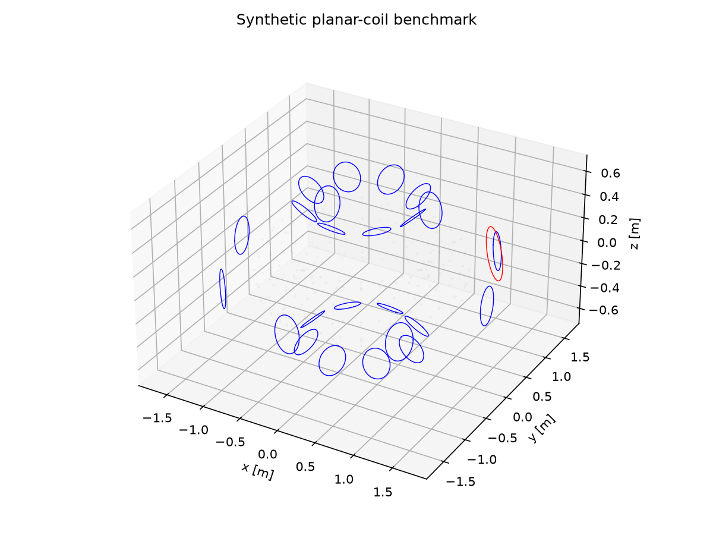
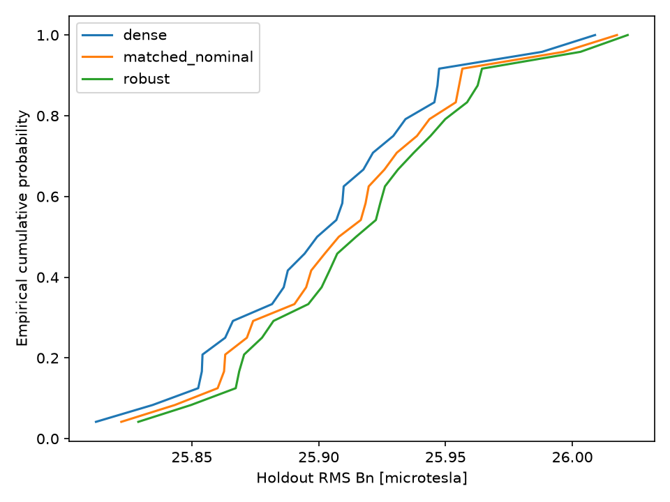

# Robust Optimization and Independent Validation of Planar-Coil Magnetic-Field Models

**Final independent computational research demonstration | 3 November 2026**

**Research demonstration: COMPLETE WITH DOCUMENTED LIMITATIONS.**
**Scientific comparison: FAIL. Production acceptance: FAIL.**
**Full independent scientific validation: INCOMPLETE. Numerical root cause: INCONCLUSIVE.**

This report consolidates existing research. All numerical measurements and figures are historical; none was freshly computed for this finalization. The existing Python 3.11 environment launcher failed before startup. No numerical dependencies, algorithms, configurations or acceptance criteria were changed. This is not a newly verified research checkpoint. PR #7 remains open and unmerged according to the established project record; no new remote observation is asserted.

*Reading and rendering:* this Markdown manuscript uses ten suggested page groups, separated by print page breaks. A renderer supporting display mathematics and HTML print breaks is recommended. Actual pagination depends on fonts, paper size and image scaling; no rendered page count is certified. The presentation and portfolio are separate deliverables.

## 1. Executive Summary

The project implements a reproducible synthetic vacuum magnetic-field correction problem: choose currents in 24 planar shaping coils to reduce the area-weighted normal magnetic field on a toroidal boundary. A separate energized coil supplies a nonzero disturbance. The implementation combines exact straight-segment Biot–Savart evaluation, a linear magnetic response matrix, constrained least squares, sparse support selection, finite-scenario minimax optimization, paired uncertainty evaluation and static single-coil recovery.

The original quick benchmark uses 512 polygon segments per circle, 240 training points and a shifted 960-point evaluation grid. Historical dense optimization reduced fine-grid RMS from 30.95589774 to 25.91442556 microtesla. A sparse four-active-coil example achieved 26.14463797 microtesla. These are useful demonstrations of constrained approximation and support tradeoffs within a deliberately reduced model.

The robust formulation did **not** demonstrate improved holdout performance. On the original 24 paired scenarios, robust-minus-matched-nominal mean RMS was **+0.006260212 microtesla**, with positive differences in every pair. Four later finite-scenario comparisons likewise worsened all tested paired holdout RMS values. Successful solution of a sampled minimax objective is distinct from generalized robustness.

Independent checks established historical sampled accuracy and local reproducibility within specified scopes. Later recovery-ratio comparisons failed stringent cross-environment tolerances, while full original-input reproduction, complete field validation and causal attribution remained incomplete. Small residuals and moderate matrix conditioning do not certify stability of a ratio formed from nearly equal RMS quantities. The final scientific disposition is **NOT ACCEPTED FOR PRODUCTION USE**.

The contribution is a transparent computational demonstration with preserved adverse findings, rather than a validated coil design or a physical fusion-device performance result. There is no employment, collaboration, endorsement or scientific validation by Thea Energy, and no proprietary device geometry is reproduced.

## 2. Research Motivation

Planar coils offer a mathematically accessible setting for studying magnetic inverse problems. Once geometry is fixed, vacuum fields depend linearly on currents, while current limits, sparse hardware choices and geometric uncertainty introduce optimization and validation questions. The public sparse-regression literature motivates normal-field correction as an objective [1]; the geometry and experiments here are independently constructed.

The research questions are narrowly computational: how much normal-field residual can bounded currents remove; what residual/current/support tradeoffs arise; does finite-scenario minimax training help on a locked synthetic holdout; and how sensitive are static recovery metrics to coil loss and numerical arithmetic? The demonstration records negative answers where supported. It does not treat optimization success as proof of scientific adequacy.

Normal-field RMS is an approximation metric on a prescribed boundary. No plasma equilibrium, total confining field, magnetic surfaces or particle trajectories are solved. Accordingly, a smaller residual cannot be interpreted as improved confinement. Published device objectives provide context without transferring their geometry, results or validation to this project.

## 3. Mathematical Problem Formulation

Let the target surface be \(S\), with outward unit normal \(\mathbf n\), and let \(\mathbf B_j\) denote field per ampere from shaping coil \(j\). With prescribed disturbance \(\mathbf B_0\),

\[
\mathbf B(\mathbf p;\mathbf I)=\mathbf B_0(\mathbf p)+\sum_{j=1}^{24}I_j\mathbf B_j(\mathbf p),\qquad
r(\mathbf p;\mathbf I)=\mathbf n(\mathbf p)\cdot\mathbf B(\mathbf p;\mathbf I).
\tag{1}
\]

The continuum motivation is the normalized surface norm

\[
\mathcal R(\mathbf I)=\left(\frac{1}{|S|}\int_S r(\mathbf p;\mathbf I)^2\,dS\right)^{1/2}.
\tag{2}
\]

The executed problem replaces the integral by positive quadrature weights \(w_i\), normalized so \(\sum_iw_i=1\). Thus \(R_h=\sqrt{\sum_iw_i r_i^2}\) has units tesla. Peak observations instead sample \(\max_i|r_i|\); they are not interchangeable with RMS. A finite sample maximum is a lower bound on the surface supremum for that field model.

Command currents satisfy \(|I_j|\le I_{\max}=3000\) A. An allowed support \(J\) imposes \(I_j=0\) outside \(J\). Sparse selection and recovery change this support; the magnetic geometry remains fixed in nominal optimization. Training discretization and evaluation discretization are deliberately distinct, so improvement in one objective need not imply improvement in the other.

All lengths are metres, currents amperes and fields tesla. Reported microtesla values equal tesla values multiplied by \(10^6\). The fixed scale \(B_{\rm ref}=10^{-3}\) T nondimensionalizes the objective; it is not the total magnetic-field magnitude or a guide-field prescription.

## 4. Synthetic Planar-Coil Geometry

For toroidal angle \(\phi\) and poloidal angle \(\theta\), the target torus is

\[
\mathbf p(\theta,\phi)=((R+a\cos\theta)\cos\phi,(R+a\cos\theta)\sin\phi,a\sin\theta),
\quad R=1,\ a=0.25,
\tag{3}
\]

\[
\mathbf n=(\cos\theta\cos\phi,\cos\theta\sin\phi,\sin\theta),\quad
dS=a(R+a\cos\theta)\,d\theta\,d\phi,\quad |S|=4\pi^2Ra.
\tag{4}
\]

The 24 shaping circles occupy eight toroidal by three poloidal locations on a winding torus of minor radius 0.65 m. Each radius is 0.16 m and each plane is tangent to the winding torus. For an oriented orthonormal frame \((\mathbf u_j,\mathbf v_j)\),

\[
\mathbf c_j(\alpha)=\mathbf q_j+0.16(\mathbf u_j\cos\alpha+\mathbf v_j\sin\alpha),
\quad \mathbf u_j\times\mathbf v_j=\mathbf n_j.
\tag{5}
\]

The separate disturbance coil has radius 0.22 m, current 1500 A, center \((1.6,0.25,0.35)\), and normal proportional to \((1,0.2,0.4)\). It prevents a trivial zero-current optimum. Positive current follows the right-hand orientation. No analytic toroidal guide field is required for this correction-only objective.

*Figure 1. Original quick geometry: planar shaping coils, toroidal evaluation points and separate disturbance coil. Historical computed figure, reused without alteration.*

Phase 2B introduced an explicit Householder-based frame convention and finite dyadic peak-search contract while retaining the original benchmark. Circle geometry is phase invariant, but finite inscribed polygons are not; the versions therefore have distinct result hashes. The frame convention has a chart boundary and is not claimed globally smooth. Its historical tests and limitations are documented in [Phase 2B methods](PHASE2B_METHODS.md).

## 5. Biot-Savart Magnetic-Field Modeling

The vacuum filament field is

\[
\mathbf B(\mathbf p)=\frac{\mu_0 I}{4\pi}\oint_C
\frac{d\boldsymbol\ell\times(\mathbf p-\mathbf c)}{|\mathbf p-\mathbf c|^3},
\qquad \mu_0\approx4\pi\times10^{-7}\ {\rm H/m}.
\tag{6}
\]

This conventional approximation is not an assertion that \(\mu_0\) is exact in modern SI. Each circle is represented by a closed inscribed polygon. For a segment with endpoint-to-observer vectors \(\mathbf r_1,\mathbf r_2\), its exact straight-filament contribution is

\[
\mathbf B_{\rm seg}=\frac{\mu_0 I}{4\pi}
\frac{(\mathbf r_1\times\mathbf r_2)(|\mathbf r_1|+|\mathbf r_2|)}
{|\mathbf r_1||\mathbf r_2|\,[|\mathbf r_1||\mathbf r_2|+\mathbf r_1\cdot\mathbf r_2]}.
\tag{7}
\]

Exact integration on a segment does not eliminate circle-approximation error. The implementation rejects observers within \(10^{-4}\) m of a segment, treats collinear exterior contributions as zero, and evaluates bounded point batches. Analytical axial-loop fields provide a distinct reference:

\[
B_z(z)=\frac{\mu_0 I r_c^2}{2(r_c^2+z^2)^{3/2}},\qquad B_z(0)=\frac{\mu_0 I}{2r_c}.
\tag{8}
\]

Independent midpoint integration checks polygon fields; adaptive circular integration separates polygon geometry error from integration-formula agreement. Historical results show approximately second-order convergence away from wires. These checks address a sampled filament model, not finite conductor cross-sections or plasma response.

## 6. Magnetic Response Matrix

At surface point \(i\), define

\[
A_{ij}=\mathbf n_i\cdot\mathbf B_j(\mathbf p_i)\quad[\mathrm{T/A}],\quad
b_i=\mathbf n_i\cdot\mathbf B_0(\mathbf p_i),\quad \mathbf r=\mathbf b+A\mathbf I.
\tag{9}
\]

Set \(\mathbf I=I_{\max}\mathbf x\), \(D=AI_{\max}/B_{\rm ref}\), \(\mathbf d=\mathbf b/B_{\rm ref}\), and \(W=\operatorname{diag}(w_i)\). Then the dimensionless residual is \(\mathbf d+D\mathbf x\), with \(|x_j|\le1\). Precomputation reduces each fixed-geometry solve to linear algebra. Perturbed geometry requires its own response evaluation.

The original quick weighted dimensionless response has recorded rank 24 and condition number 1.94734884. This supports the numerical interpretation of that matrix only. It does not bound cancellation in recovery quotients, characterize every perturbed problem or certify the complete independent model. The training matrix has 240 rows; the shifted evaluation grid has 960 points.

## 7. Constrained Current Optimization

The bounded nominal ridge problem is

\[
\min_{\mathbf x}\ f(\mathbf x)=\|W^{1/2}(\mathbf d+D\mathbf x)\|_2^2+\lambda\|\mathbf x\|_2^2,
\quad |x_j|\le1,\quad x_j=0\ (j\notin J),\quad \lambda=10^{-6}.
\tag{10}
\]

The ridge term has an explicit dimensionless interpretation. Augmenting the weighted response with \(\sqrt\lambda\,\mathrm{Id}\) and the right-hand side with zeros gives bounded least squares. The unregularized comparison sets the ridge term to zero. Constraints apply to commanded currents; uncertainty can make actual currents exceed those bounds.

Convexity follows from the positive semidefinite quadratic Hessian; positive ridge gives strict convexity on free coordinates. This mathematical property does not by itself certify an implementation's returned solution. Historical checks include independent normal-equation comparisons on reference problems, support exclusion, bounds, solver success and derivative checks. The observed quick command-bound violation was zero.

## 8. Sparse and Robust Optimization

Sparse selection uses the box-constrained objective

\[
\min_{|x_j|\le1}\ \tfrac12 f(\mathbf x)+\tau\|\mathbf x\|_1.
\tag{11}
\]

FISTA applies soft thresholding followed by clipping to the box. The original penalty path is \(10^{-6},10^{-5},10^{-4},10^{-3},10^{-2}\). A physical 1 A threshold selects support; each selected support is then refitted under the same bounds and ridge. Optimize-then-delete separately removes the smallest absolute current and refits repeatedly. The resulting tradeoff samples are not a certified globally optimal cardinality frontier.

For sampled uncertainty scenarios \(s\in\mathcal S_{\rm train}\), the minimax epigraph is

\[
\min_{\mathbf x,t}\ t+\lambda\|\mathbf x\|_2^2\quad
\text{subject to }\|W^{1/2}(\mathbf d_s+D_s\mathbf x)\|_2^2\le t\quad\forall s,
\quad |x_j|\le1,\quad x_j=0\ (j\notin J).
\tag{12}
\]

Scenario gain/offset effects are included in the scenario affine residual. SLSQP uses analytic derivatives, \(\mathrm{ftol}=10^{-12}\), and at most 2000 iterations; solver failure or epigraph violation above \(10^{-8}\) raises. Original quick robust optimization succeeded in 32 iterations, with recorded violation \(8.385219602002891\times10^{-16}\). This demonstrates numerical feasibility in that execution, not an independent universal optimality certificate.

Matched nominal and robust fits share the 12-coil deletion-path allowed support and bounds. They do not share a total-current constraint and can differ in realized active counts. Later numerical primal-dual checks concern only the finite sampled training objective. Neither the word “robust” nor convexity implies holdout superiority, CVaR control or distribution-free guarantees.

## 9. Uncertainty Quantification

The synthetic uncertainty model independently samples each translation component uniformly in \([-0.003,0.003]\) m and each rotation-vector component in \([-0.01,0.01]\) rad, about the coil center. Current gains and additive offsets satisfy

\[
I_j^{\rm actual}=(1+g_j)I_j^{\rm command}+o_j,\quad
g_j\sim U[-0.02,0.02],\quad o_j\sim U[-2,2]\ {\rm A}.
\tag{13}
\]

The disturbance remains fixed. Rigid transforms preserve coil planarity. A conservative torus-distance bound uses vertex signed distance minus half the largest edge length to enforce a 0.05 m surface clearance; invalid draws abort rather than being silently resampled. These are assumed distributions, not measured manufacturing statistics, and omit bias and correlations.

The original training/holdout seeds are 20261029/20261030, with 8/24 scenarios. Both evaluation angular resolutions double and shift by half a cell relative to training. Every method uses the same holdout draws. Summaries include empirical means, medians, quantiles and maxima, rather than population guarantees. Actual holdout bound violation happened to be zero in the original record, but the actuation model does not enforce it generally.

Phase 2 used a locked 64-scenario holdout and four predeclared training seed/count combinations. Its paired percentile bootstrap used 2000 resamples; those conditional intervals describe simulated sampling uncertainty, excluding model-distribution and numerical uncertainty. Shared holdout data also make the four comparisons dependent.

## 10. Single-Coil Failure and Recovery

Each of the 21 nominally active dense coils is failed separately. Frozen failure sets that command to zero; recovery refits only surviving coils. Under actuation uncertainty, the failed additive offset is removed too, enforcing exactly zero actual failed-coil current. Recovery is static and contains no voltage, time-response or hardware model.

For pre-failure, frozen-failure and recovered fine-grid RMS values \(B,L,P\), the recorded fractional recovery is

\[
R_f=\frac{L-P}{L-B},\qquad |L-B|>10^{-15}\ {\rm T}.
\tag{14}
\]

Guarded denominators yield undefined values; negative or above-one ratios are preserved. Coil 3 has original recovery \(-0.4146890\), while coil 15 has \(1.0317964\). Training-grid ridge minimization does not ensure monotone fine-grid RMS. These values must not be clipped into a success range.

Phase 2C introduced a versioned algebraically equivalent energy evaluation. With \(E(x)=\sum_iw_i r_i(x)^2\) and \(\delta=A(x-y)\) for physical currents,

\[
E(x)-E(y)=\sum_iw_i\delta_i[2r_i(y)+\delta_i],\qquad
R_f=\frac{E_L-E_P}{E_L-E_B}\frac{L+B}{L+P}.
\tag{15}
\]

Factoring mitigates subtraction loss without changing the mathematical metric. Binary64 input perturbations remain amplified: \(dR_f=[(1-R_f)dL-dP+R_f dB]/(L-B)\). Thus the denominator guard is not a stability certificate. Later cross-environment failures remain unresolved despite local high-precision agreement for recorded inputs.

## 11. Numerical Experiments and Results

### Original quick benchmark

All entries below are historical values from [the original report](RESEARCH_REPORT.md) and [raw results](../results/quick/results.json). RMS units are microtesla; active means absolute command above 1 A. “Fine” is the shifted 20 by 48 grid. No row is a new execution.

| Method | Active | Training RMS | Fine RMS | Holdout mean | Holdout q95 | Sum absolute current [A] |
|---|---:|---:|---:|---:|---:|---:|
| Zero | 0 | 30.48271525 | 30.95589774 | 30.95556475 | 30.97388508 | 0.000000 |
| Dense ridge | 21 | 25.75951507 | 25.91442556 | 25.90215549 | 25.98194891 | 2069.970450 |
| Unregularized | 21 | 25.75951457 | 25.91415816 | 25.90188738 | 25.98168705 | 2070.683218 |
| L1 selection, tau=1e-5 | 19 | 25.75966411 | 25.91451474 | 25.90223572 | 25.98203978 | 2061.611041 |
| L1 selection, tau=1e-4 | 4 | 26.00128626 | 26.14463797 | 26.13191336 | 26.20933493 | 1368.523353 |
| Matched nominal | 12 | 25.77040435 | 25.92337147 | 25.91100497 | 25.99049756 | 1966.443954 |
| Finite-scenario robust | 12 | 25.77134351 | 25.92944605 | 25.91726518 | 25.99735802 | 1970.744293 |

*Table 1. Selected original quick methods. L1 rows describe support-selected bounded refits, not an assertion of optimal fixed-cardinality design.*

The robust-minus-matched-nominal paired mean is +0.006260212 microtesla, with observed range [+0.004224770,+0.008019145]. Positive denotes worse robust RMS. Equal support is not equal total current: the robust fit used 1970.744293 A in absolute sum against 1966.443954 A. The data support a negative robust-performance finding under this synthetic evaluation.

*Figure 2. Original 24-scenario empirical cumulative distributions. The robust curve lies toward larger RMS values. This is descriptive evidence, not a population-tail certificate.*

### Later bounded comparisons and peak observations

The [Phase 2 results](PHASE2_RESULTS.md) report four comparisons on one 64-scenario holdout. These are historical experiments rather than additional work for finalization.

| Training seed / count | Mean robust-minus-nominal [microT] | Conditional paired bootstrap 95% [microT] | Fraction improved |
|---|---:|---|---:|
| 20261111 / 4 | +0.0082193419 | [0.0080124646, 0.0084201096] | 0 |
| 20261111 / 8 | +0.0079980561 | [0.0077950886, 0.0081959359] | 0 |
| 20261112 / 4 | +0.0070391762 | [0.0068644322, 0.0072019423] | 0 |
| 20261112 / 8 | +0.0004417850 | [0.0003894518, 0.0004921714] | 0 |

*Table 2. The sampled minimax training objective decreased in every trial, while every paired holdout RMS worsened. Intervals are conditional on the frozen fits and assumed scenario distribution.*

Objective mismatch and finite training coverage are plausible explanations, not uniquely established causes. Training uses maximum squared residual, while evaluation includes RMS means and tails. These distinct functionals and finite samples make general outperformance unjustified.

| Original Phase 2 method | Finest shifted sample [microT] | Local polygon estimate [microT] | Smooth-circle field at candidate [microT] |
|---|---:|---:|---:|
| Dense | 298.3499580701 | 299.3326578416 | 299.3378597474 |
| Matched nominal | 298.3206634311 | 299.3101488827 | 299.3153502217 |
| Robust | 298.2983505299 | 299.2656670560 | 299.2708674977 |

*Table 3. Peak observations for the original Phase 2 nominal-geometry fields. Smooth values are evaluations at polygon-search candidates, not independently certified global extrema. The ordering here does not establish robust uncertainty performance.*

### Recovery results and historical failure record

| Failed coil | Pre RMS [microT] | Frozen RMS [microT] | Recovered RMS [microT] | Original fractional recovery |
|---:|---:|---:|---:|---:|
| 0 | 25.9144256 | 28.5706666 | 28.1681606 | 0.1515322 |
| 3 | 25.9144256 | 25.9144802 | 25.9145029 | -0.4146890 |
| 6 | 25.9144256 | 25.9149476 | 25.9148603 | 0.1672662 |
| 8 | 25.9144256 | 26.1606579 | 26.0350815 | 0.5099915 |
| 15 | 25.9144256 | 25.9145404 | 25.9144219 | 1.0317964 |

*Table 4. Selected original outages; the original report contains all 21. Rounded RMS values must not be used to regenerate sensitive ratios.*

Phase 2B retained 145 legacy peak discrepancies. Phase 2C documented locally improved ratio evaluation against 60/90-digit recorded-input references, but did not erase earlier failures. The final disposition retains 21 failures in run 41256776296, 11 in run 41257645149 and earlier 22 scalar-path failures as separate historical observations. They are neither a pooled count of independent trials nor newly reproduced failures in this finalization.

## 12. Independent Model Validation

### Historical sampled accuracy

The original [validation report](VALIDATION_REPORT.md) records 11 passing tests, nine passing independent audit gates and a full repeated quick execution matching at rtol=1e-11, atol=1e-13. Both [audit](../results/quick/audit.json) and [repeat record](../results/quick/reproducibility.json) bind to the original result-file SHA256 below. Historical test output is retained separately in [tests.json](../results/quick/tests.json); it does not contain its own result-hash binding. These records are historical, not a current full-suite pass.

| Historical check | Measurement | Scope |
|---|---:|---|
| Independent midpoint normal-field discrepancy | 1.87806855571e-15 T | Polygon response agreement |
| 256-to-512 relative RMS change | 6.16264454907e-5 | Below unchanged 1e-4 gate |
| 512 residual relative to smooth reference | 2.0680659495e-5 | Fixed-current sampled residual |
| 512-to-1024 relative RMS change | 1.54057565864e-5 | Refinement diagnostic |
| Finest shifted-grid relative RMS change | 2.69114579645e-5 | RMS sampling sensitivity |
| Peak, 20x48 to 40x96 | 287.9772607004 to 298.3499580701 microT | Peak still changes about 3.6% |

*Table 5. Recorded original checks. RMS agreement does not imply continuum-peak convergence.*

The original 128-to-256 refinement failed: relative change 2.465637237225593e-4 exceeded 1e-4. That diagnostic held the original 64-segment currents fixed. The later optimized-current audit uses different fixed currents; the two tables must not be conflated. The [diagnosis](REFINEMENT_DIAGNOSIS.md) attributes the original refinement failure to insufficient geometric resolution. Quick geometry was raised to 512 segments without relaxing the gate. That resolved historical discretization finding is distinct from the inconclusive later cross-platform numerical root cause.

### Provenance and remaining independent-validation gaps

The following local data hashes were freshly read during documentation preparation and match the historical reports. Hash verification establishes byte identity, not fresh numerical correctness.

| Data file | SHA256 |
|---|---|
| [Original quick](../results/quick/results.json) | `83162de245bfa5f64fad773f0c8212ccb04d2ae8af8287c03589fd8ee8374889` |
| [Phase 2 study](../results/phase2/study.json) | `395027e9fdda163448789beda6b1c7eb7d1537d6024d0a0ee32790ddf53bb258` |
| [Phase 2B study](../results/phase2b/study/study.json) | `c8f1cf9df1cdc6fb8eb5ab8595ede2015aee4647671d98142205ec1ec8f2a960` |
| [Phase 2C study](../results/phase2c/study/study.json) | `20f28ceb4a195c15c04d5ec3b36bc95ae65399cc540d8782eb593fc1fce63eca` |

The original quick metadata records source commit `d711580800820b3b38bcd7006994c58b4665226c` with dirty flag true. No clean-source generation claim is made. Later configurations and [Phase 2](../results/phase2/manifest.json), [Phase 2B](../results/phase2b/manifest.json) and [Phase 2C](../results/phase2c/manifest.json) manifests preserve version distinctions.

The [final disposition](PHASE2D_FINAL_ROOT_CAUSE_AND_ACCEPTANCE.md) records 71 matching original archive digests and remote associations, 1,155 member byte strings and 53 numerical input members with four distinct hashes. Of 1,379 parsed seal references, 300 lacked their interpreted paths but had same-run digest matches. Their path associations remain unproven. Repeated hashes are not independent experiment counts; archive authentication does not establish complete semantic/source authentication.

The [STEP 52 assessment](PHASE2D_STEP52_FINAL_SCIENTIFIC_ACCEPTANCE.md) retains six failed and two passing scalar ratio comparisons across eight unique saved/fresh pairs. Full original worker-current binding, independent complete Bxyz reconstruction, smooth-coil validation and four controlled matched-input environments remain incomplete. Historical denominators around 5.46648534046e-11 T and 5.22068671047e-10 T exceed the guard but remain cancellation sensitive. No unique OS, NumPy, SciPy, BLAS or CPU-dispatch cause has been established.

## 13. Scientific Limitations

The model is a vacuum-filament correction problem on a synthetic prescribed torus. It omits plasma response, equilibrium, field-line topology, conductor thickness, coil-to-coil engineering clearance, magnetic forces, voltage, power, thermal constraints and dynamic recovery. Surface-clearance checks do not establish hardware feasibility. There is no external SIMSOPT numerical comparison or physical experimental validation.

Finite surface sampling and polygon resolution limit accuracy. Local peak searches and finite dyadic searches return observed values without global certificates. Adaptive quadrature error estimates and converged high-precision arithmetic are diagnostics rather than interval proofs. A numerical finite-scenario primal-dual gap does not prove physical robustness.

Uncertainty is assumed independent and uniform. Small holdouts cannot establish precise population tails, manufacturing reliability or distribution-free guarantees. Shared allowed supports do not equate current usage. The negative robust-performance finding applies to the executed synthetic comparisons, and does not prove that all robust formulations fail.

Cancellation-sensitive recovery ratios failed historical scientific comparisons. Algebraic stabilization improved a local versioned evaluation but did not establish cross-platform acceptance. Full independent scientific validation remains INCOMPLETE; numerical root cause remains INCONCLUSIVE. Historical local PASS records cannot supersede the final adverse disposition in [scientific-verdict.json](phase2d-final-evidence/scientific-verdict.json).

For this documentation task, the existing `.venv/Scripts/python.exe --version` attempt failed before Python startup with the recorded missing-base-interpreter message. No quick benchmark, analytical validation, audit, full repeat or new test suite executed. No environment substitution or dependency installation was attempted. Documentation integrity is checked separately from numerical validation.

## 14. Research Contributions

The demonstration brings together an explicit SI geometry, a dimensionless optimization formulation and traceable finite numerical experiments. It shows how linear magnetic responses support bounded and sparse current fitting; how sampled minimax objectives can improve training while worsening holdout; and how static recovery performance depends on support, evaluation grids and derived-metric conditioning.

Its mathematical contribution is the applied formulation and analysis within this benchmark, including the energy-difference identity and recovery sensitivity explanation. These are established mathematical tools applied transparently, with no priority claim for new optimization theory. The computational contribution includes independent integration checks, versioned benchmark contracts, paired scenario records and preserved failed evidence. Reproducibility limits are part of the result.

## 15. Conclusions

The computational implementation and final research demonstration are complete. The benchmark demonstrates constrained normal-field correction, sparse tradeoffs, finite-scenario minimax training and static coil-outage refitting. It also demonstrates negative holdout robustness results and unresolved numerical recovery-ratio failures.

**Research demonstration: COMPLETE WITH DOCUMENTED LIMITATIONS. Full scientific acceptance: NOT ESTABLISHED. Scientific comparison: FAIL. Production acceptance: FAIL. Final scientific disposition: NOT ACCEPTED FOR PRODUCTION USE.** The independent investigation is concluded for this demonstration with validation incomplete and numerical root cause inconclusive. No further numerical investigation is initiated by this report. Historical evidence is preserved; PR #7 remains open and unmerged under the established record.

## 16. References

The public bibliography below is transcribed from [source verification](SOURCE_VERIFICATION.md), which records access on 29 October 2026. Sources were not newly reviewed for this finalization; no external figures or device geometry are reproduced.

1. R. Wu, T. Kruger and C. Swanson. *Planar Coil Optimization for the Eos Stellarator using Sparse Regression*. arXiv:2502.07702, 2025. [Recorded source](https://arxiv.org/abs/2502.07702).
2. SIMSOPT documentation. *simsopt.field package*. [Recorded source](https://simsopt.readthedocs.io/latest/simsopt.field.html). Background interface/reference only; no cross-package validation is claimed.
3. T. G. Kruger, D. A. Gates, D. W. Dudt, R. Wu and the Thea Energy team. *Optimization of the Planar Coil Stellarator*. 66th APS-DPP, Atlanta, 7–11 October 2024. [Recorded public presentation](https://thea.energy/wp-content/uploads/2024/10/Optimization-of-the-Planar-Coil-Stellarator_APS-DPP-24.pdf). Citation does not imply affiliation or endorsement.
4. Project methods and original evidence: [scientific methods](SCIENTIFIC_METHODS.md), [research report](RESEARCH_REPORT.md), [validation report](VALIDATION_REPORT.md), [limitations](LIMITATIONS.md), [execution status](EXECUTION_STATUS.md).
5. Extended benchmark records: [Phase 2 methods](PHASE2_METHODS.md), [results](PHASE2_RESULTS.md), [Phase 2B methods](PHASE2B_METHODS.md), [results](PHASE2B_RESULTS.md), [Phase 2C methods](PHASE2C_METHODS.md), [results](PHASE2C_RESULTS.md), [Phase 2D methods](PHASE2D_METHODS.md), [results](PHASE2D_RESULTS.md).
6. Final adverse scientific assessments: [root-cause and acceptance disposition](PHASE2D_FINAL_ROOT_CAUSE_AND_ACCEPTANCE.md), [STEP 52 assessment](PHASE2D_STEP52_FINAL_SCIENTIFIC_ACCEPTANCE.md), [machine-readable verdict](phase2d-final-evidence/scientific-verdict.json).
