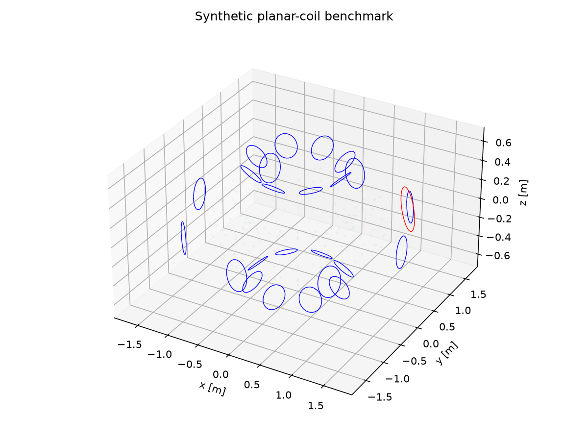
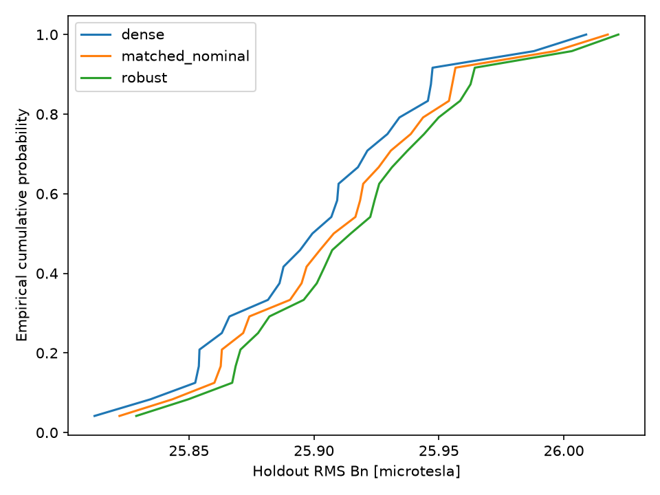

# Final Research Presentation

Ten-slide scientific presentation manuscript | 3 November 2026. All numerical results and figures are historical; no fresh benchmark ran. Horizontal rules separate slides. Mathematical notation follows the [final report](FINAL_RESEARCH_DEMONSTRATION_REPORT.md). No rendered deck is claimed.

## Slide 1: Research Title and Objective

**Robust Optimization and Independent Validation of Planar-Coil Magnetic-Field Models**

Reduce normal magnetic-field RMS on a synthetic torus using bounded currents in 24 planar shaping coils.

- Study sparse selection, finite-scenario minimax training and static fault recovery.
- Preserve negative results and distinguish numerical checks from scientific acceptance.
- Demonstration: **COMPLETE WITH DOCUMENTED LIMITATIONS**.
- Final scientific disposition: **NOT ACCEPTED FOR PRODUCTION USE**.

Independent research; no Thea Energy employment, collaboration, endorsement or scientific validation.

Source: [final disposition](PHASE2D_FINAL_ROOT_CAUSE_AND_ACCEPTANCE.md).

---

## Slide 2: The Mathematical Challenge

\[
r(\mathbf p;\mathbf I)=\mathbf n\cdot\left(\mathbf B_0+\sum_{j=1}^{24}I_j\mathbf B_j\right),\qquad
R_h=\sqrt{\sum_iw_i r_i^2},\quad \sum_iw_i=1.
\]

- Solve an inverse problem under command bounds of ±3000 A.
- Balance residual, current regularization and allowed coil support.
- Separate training-grid loss, shifted-grid RMS and observed peak fields.
- Normal-field correction is a reduced vacuum-field objective; confinement is not evaluated.

Source: [scientific methods](SCIENTIFIC_METHODS.md).

---

## Slide 3: Synthetic Planar-Coil Geometry

- Target torus: major radius 1 m, minor radius 0.25 m.
- 24 circles: eight toroidal by three poloidal positions; coil radius 0.16 m.
- Separate 1500 A disturbance coil; 512 polygon segments per circle.
- Original quick grid: 240 training points; shifted 960-point evaluation grid.

Historical computed figure. Source: [geometry and assumptions](SCIENTIFIC_METHODS.md), [quick configuration](../configs/quick.json).

---

## Slide 4: Biot-Savart Magnetic-Field Model

\[
\mathbf B(\mathbf p)=\frac{\mu_0 I}{4\pi}\oint_C
\frac{d\boldsymbol\ell\times(\mathbf p-\mathbf c)}{|\mathbf p-\mathbf c|^3},\qquad
A_{ij}=\mathbf n_i\cdot\mathbf B_j(\mathbf p_i).
\]

- Exact straight-segment integration on an inscribed polygon.
- Linear response: \(\mathbf r=\mathbf b+A\mathbf I\), with \(A\) in T/A.
- Historical checks: analytical loop fields, independent midpoint and smooth-circle integration.
- Original 256-segment refinement failed; 512 segments retained the **1e-4** gate.
- Polygon integration accuracy and smooth-geometry accuracy are separate questions.

Source: [validation report](VALIDATION_REPORT.md), [preserved failed refinement](REFINEMENT_DIAGNOSIS.md).

---

## Slide 5: Current Optimization Formulation

\[
\min_{|x_j|\le1}\ \|W^{1/2}(\mathbf d+D\mathbf x)\|_2^2+\lambda\|\mathbf x\|_2^2,
\quad \mathbf I=3000\mathbf x,\quad \lambda=10^{-6}.
\]

\(D=A I_{\max}/B_{\rm ref}\), \(\mathbf d=\mathbf b/B_{\rm ref}\), \(B_{\rm ref}=10^{-3}\) T.

- Bounded ridge least squares establishes the dense baseline.
- Box-constrained L1/FISTA selects supports, followed by bounded refitting.
- Optimize-then-delete supplies sampled support/current/residual tradeoffs.
- Historical fine RMS: zero **30.95589774**, dense **25.91442556**, four-active-coil sparse example **26.14463797 microT**.

Source: [original research report](RESEARCH_REPORT.md). Tradeoffs are not certified global cardinality optima.

---

## Slide 6: Robust Optimization and Uncertainty

\[
\min_{\mathbf x,t}\ t+\lambda\|\mathbf x\|_2^2,
\quad \|W^{1/2}(\mathbf d_s+D_s\mathbf x)\|_2^2\le t\quad\forall s\in\mathcal S_{\rm train}.
\]

- Original quick: 8 training and 24 paired holdout scenarios; disjoint seeds.
- Componentwise uniform translations ±3 mm, rotation-vector components ±0.01 rad, gains ±2%, offsets ±2 A.
- Matched nominal and robust fits share a 12-coil allowed support; total current is not matched.
- Robust-minus-nominal mean holdout RMS: **+0.006260212 microT**; positive is worse.
- Finite-scenario minimax provides no generalized robustness or population-tail guarantee.

Source: [methods](SCIENTIFIC_METHODS.md), [original negative finding](RESEARCH_REPORT.md).

---

## Slide 7: Coil Failures and Recovery

\[
R_f=\frac{L-P}{L-B},\qquad
dR_f=\frac{(1-R_f)dL-dP+R_f dB}{L-B}.
\]

\(B,L,P\): pre-failure, frozen-failure and recovered fine-grid RMS.

- All 21 nominally active dense coils were individually removed; surviving currents were refitted.
- Failed actual current is exactly zero, including removal of additive offset.
- Original coil 3 recovery: **−0.4146890**; coil 15: **1.0317964**. Values remain unclipped.
- Energy-difference factoring reduced local evaluation cancellation; later recovery comparisons still failed.
- Denominator guard **1e-15 T** does not certify stability. Static refitting is not dynamic hardware recovery.

Source: [Phase 2C methods](PHASE2C_METHODS.md), [final disposition](PHASE2D_FINAL_ROOT_CAUSE_AND_ACCEPTANCE.md).

---

## Slide 8: Numerical Results and Figures

| Original quick method | Fine RMS [microT] | Holdout mean [microT] | Holdout q95 [microT] |
|---|---:|---:|---:|
| Dense | 25.91442556 | 25.90215549 | 25.98194891 |
| Matched nominal | 25.92337147 | 25.91100497 | 25.99049756 |
| Robust | 25.92944605 | 25.91726518 | 25.99735802 |

Historical computed figure and values. Four later 64-scenario comparisons also worsened every paired holdout RMS. No robust outperformance is established.

Sources: [original results](RESEARCH_REPORT.md), [Phase 2 results](PHASE2_RESULTS.md). Original result SHA256: `83162de245bfa5f64fad773f0c8212ccb04d2ae8af8287c03589fd8ee8374889`.

---

## Slide 9: Independent Validation and Limitations

- Historical quick audit: 512-segment relative residual error **2.0680659495e-5**; configured relative RMS change **6.16264454907e-5**, below unchanged 1e-4 gate.
- Historical audit and repeat records bind to the original result SHA256; no fresh numerical validation ran for finalization because the Python launcher failed before startup.
- Later full independent field validation and matched-environment causal experiments: **INCOMPLETE**.
- Recovery-ratio validation and scientific comparison: **FAIL**. Numerical root cause: **INCONCLUSIVE**.
- Retain separate historical 21-, 11- and 22-failure observations; local PASS records do not erase them.
- No continuum-peak certificate, plasma equilibrium, confinement or engineering validation.

Sources: [historical validation](VALIDATION_REPORT.md), [STEP 52 assessment](PHASE2D_STEP52_FINAL_SCIENTIFIC_ACCEPTANCE.md), [final verdict](phase2d-final-evidence/scientific-verdict.json).

---

## Slide 10: Conclusions and Research Contributions

- Implemented a complete synthetic field-correction demonstration with explicit mathematical scaling and constrained optimization.
- Documented sparse tradeoffs and a negative finite-scenario robust-performance result.
- Analyzed cancellation-sensitive recovery metrics and preserved failed comparisons and provenance limits.
- Demonstrated applied mathematics, scientific Python and reproducible computational research with bounded validation claims.

**Research demonstration: COMPLETE WITH DOCUMENTED LIMITATIONS.**
**Full scientific acceptance: NOT ESTABLISHED. Production acceptance: FAIL.**
**Full independent scientific validation: INCOMPLETE. PR #7: OPEN AND UNMERGED (established record).**

Independent research; no Thea Energy affiliation or endorsement. Evidence and bibliography: [final report](FINAL_RESEARCH_DEMONSTRATION_REPORT.md). Completion record: [documentation status](FINAL_DEMONSTRATION_COMPLETION.md).
